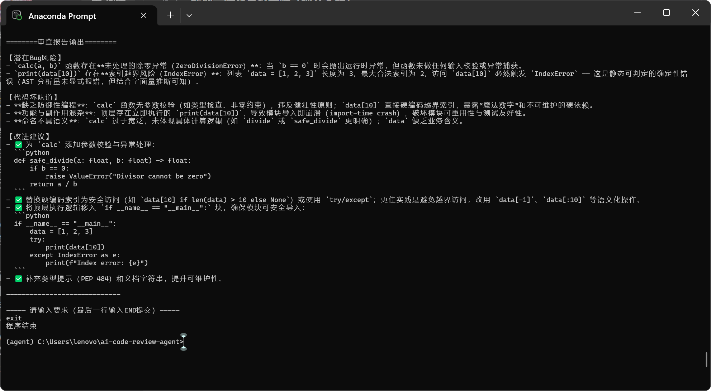

# AI Code Review Agent

基于 LangChain ReAct 架构的 Python 代码审查助手：接入通义千问大模型，

结合自研的 AST 静态分析工具，在不运行代码的前提下发现潜在 Bug、

代码坏味道，并给出改进建议。

## 功能

- 粘贴代码或读取本地 .py 文件进行审查

- AST 静态解析：提取函数与变量结构、捕获语法错误（不执行用户代码，安全）

- 大模型结合静态分析结果输出审查报告：潜在 Bug / 坏味道 / 改进建议

- 多轮对话记忆，可针对审查结果继续追问

- 完善的异常容错：解析失败、工具报错、迭代超限均不会使程序崩溃

## 技术栈

- Python 3.11

- LangChain（ReAct Agent + ConversationBufferMemory）

- LLM：通义千问 qwen-plus（DashScope API）

- 自定义工具：基于 ast 模块的静态代码分析

## 快速开始

1. 安装依赖：pip install -r requirements.txt

2. 复制 .env.example 为 .env，填入你的 DASHSCOPE_API_KEY

3. 运行：python main.py

4. 粘贴代码，最后一行输入 END 提交；或输入 file:examples/bad_code.py 审查示例文件；输入 exit 退出

## 示例

对 examples/bad_code.py 的审查可识别出：除零风险（calc 未校验 b）、

列表索引越界（data[10]），并给出修复建议。

## 设计文档

见 docs/Design.md（架构、错误处理策略与边界情况）。

## 后续改进方向

- 支持审查整个项目目录与 Git diff

- 增加 Web 界面替代命令行

- 接入更多静态检查规则（如未使用变量、命名规范）

